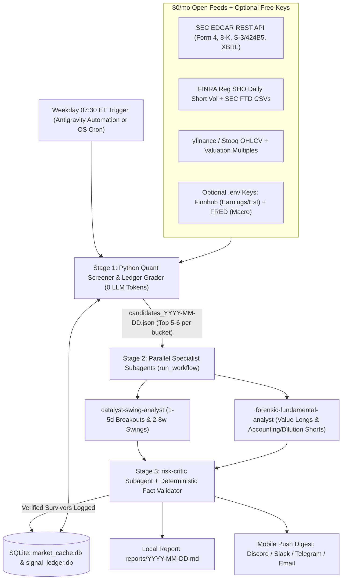

# Daily Long/Short Equity Research Agent — Architecture & Bootstrap Blueprint

> [!IMPORTANT]
> **Governance & Personal Hardware Boundary**: Run this project exclusively on your **personal machine** using **Antigravity** signed in with your personal Google Account (upgraded via `go/agy-for-googlers`), in compliance with `go/side-projects` and personal trading rules (`go/tradingpolicy`). Never clone this repository into CitC or connect it to brokerage execution APIs.

---

## 1. System Architecture Overview

The system separates **high-volume quantitative filtering** (`0` LLM tokens across ~4,000 tickers) from **deep-dive qualitative filing/catalyst synthesis** and **adversarial risk falsification**.



---

## 2. Repository & Antigravity Customization Layout

Antigravity discovers project-scoped rules, skills, subagents, hooks, and workflows from `.agents/` at the Git repository root:

```text
equity-pulse/
├── .env.example                                  # SEC_USER_AGENT, optional FINNHUB_API_KEY, FRED_API_KEY, WEBHOOK_URL
├── config/
│   └── universe.yaml                             # Liquidity floors ($50M mcap, $1M ADDV), cooldowns, blocklist (GOOG, GOOGL)
├── src/
│   ├── cli.py                                    # Entrypoints: ingest, grade-ledger, screen, validate-report, notify
│   ├── ingest/
│   │   ├── sec_edgar.py                          # Token-bucket <=8 req/s, Form 4 XML, 8-K items, S-3/424B5, XBRL companyfacts
│   │   ├── finra_short.py                        # Daily CNMSshvolYYYYMMDD.txt + biweekly SEC FTD parser
│   │   ├── market_data.py                        # Batched yfinance / Stooq OHLCV, market cap, float, RVOL, ATR
│   │   └── macro_earnings.py                     # Optional FRED regime + Finnhub earnings calendar / estimate revisions
│   ├── screener/
│   │   ├── filters.py                            # Universe gate, blocklist, ledger cooldown deduplication
│   │   ├── bucket_breakouts.py                   # Bucket 1 (1-5d): Long breakouts & Short breakdowns
│   │   ├── bucket_swings.py                      # Bucket 2 (2-8w): Insider clusters, short/FTD squeezes & deterioration
│   │   └── bucket_fundamentals.py                # Bucket 3 (1-6m+): FCF value longs & accrual/dilution/runway shorts
│   ├── ledger/
│   │   └── store.py                              # SQLite schema, +1d/+5d/+20d/+60d forward alpha vs SPY & IWM
│   └── notify/
│       └── push.py                               # Mobile markdown summary formatter (Webhook / Telegram / SMTP)
├── workflows/
│   └── daily_scan.py                             # Antigravity run_workflow orchestrator (Stage 1 -> Stage 2 -> Stage 3)
├── .agents/
│   ├── AGENTS.md                                 # Standing rules: zero hallucinated numbers, blocklist, R:R >= 2.0
│   ├── hooks.json                                # Pre/Post checks preventing writes to reports/ if fact-validator fails
│   ├── skills/
│   │   ├── market-screener/SKILL.md              # CLI usage & schema guide for src/cli.py
│   │   └── sec-forensics/SKILL.md                # Reading 8-K Item numbers, Form 4 footnotes, S-3 baby-shelf rules
│   └── agents/
│       ├── catalyst-swing-analyst.md             # Specialist subagent for Buckets 1 & 2
│       ├── forensic-fundamental-analyst.md       # Specialist subagent for Bucket 3
│       └── risk-critic.md                        # Adversarial falsifier & micro-cap squeeze/dilution auditor
├── data/                                         # Git-ignored SQLite DBs & daily candidate JSON snapshots
├── reports/                                      # Generated YYYY-MM-DD.md briefs
└── tests/                                        # Hermetic pytest suite for parsers, scoring, and ledger math
```

---

## 3. Quantitative Screening Logic (Stage 1 — Deterministic Python)

### 3.1 Universe & Safety Pre-Filter
Every ticker must pass before scoring:
1. **Exchange**: NYSE, NASDAQ, or NYSE American common equities (exclude ETFs, SPAC units/rights, ADRs without SEC filings, OTC).
2. **Blocklist**: Exclude any symbol in `config/universe.yaml` `do_not_trade` (seeded with `GOOG`, `GOOGL`).
3. **Liquidity Floor**: `market_cap >= $50,000,000` AND `avg_dollar_vol_20d >= $1,000,000` (with `price >= $2.00` to avoid sub-\$1 delisting noise).
4. **Ledger Cooldown**: Skip tickers surfaced in the same bucket within the active cooldown window (`3` trading days for Bucket 1, `10` days for Bucket 2, `30` days for Bucket 3) unless a new 8-K or Form 4 filing arrived in the last 24 hours.

### 3.2 Three-Bucket Scoring Matrix

| Bucket | Horizon | Long Setup Criteria | Short Setup Criteria | Micro-Cap (`$50M–$300M`) Safeguard |
| :--- | :--- | :--- | :--- | :--- |
| **1. Short-Term Breakouts / Breakdowns** | 1–5 days | 20-day or 55-day high close (or pre-market gap > 4% on fresh 8-K Item 1.01 / 2.02 / 8.01), `RVOL_20d >= 2.0`, `close > SMA50 > SMA200`, ATR-normalized extension <= 2.5x | Breakdown below 20-day / 50-day support on `RVOL_20d >= 2.0`, `close < SMA50`, failed earnings reaction or negative 8-K (Item 1.02, 2.06, 3.01, 4.02) | **Longs**: Penalize/flag if active S-3 or 424B5 filed within 90 days (intraday ATM dump risk). **Shorts**: Reject if float < 10M shares AND short/FTD spike present (squeeze trap). |
| **2. Multi-Week Catalyst & Positioning Swings** | 2–8 weeks | **Insider Cluster**: >= 2 C-suite/Director open-market `P` purchases (`>= $100k` combined, non-10b5-1) in 14d; OR **Short Squeeze Setup**: FINRA short-vol ratio > 50% + elevated FTDs + reclaim of 20d EMA + upward estimate revisions | **Insider Distribution + Trend Roll**: >= 3 officer sales + lower high below 50d SMA + rising FINRA short-volume trend (`5d > 20d`) + downward EPS revisions | Flag exact days-to-earnings; require `days_to_earnings >= 7` unless the trade explicitly targets post-earnings announcement drift (PEAD). |
| **3. Fundamental Value Longs & Forensic Shorts** | 1–6+ months | Positive TTM & Q-o-Q revenue growth, `FCF / EV >= 7%`, `Operating Cash Flow > Net Income`, `Net Debt / EBITDA < 2.5x`, trading within 25% of 52-week low with stabilizing RS | **Accrual Divergence**: `(Net Income - Operating Cash Flow) / Total Assets > +8%` (rising receivables/inventory vs cash), OR `< 4 quarters` cash runway with active S-3/ATM shelf dilution, OR `Altman Z < 1.8` with upcoming debt maturity | Verify baby-shelf rule (`public float < $75M` caps S-3 offerings to 1/3 of float over 12 months) vs unconstrained S-3 dilution overhang. |

---

## 4. SQLite Signal Ledger & Auto-Grading Schema

Every morning at 07:30 ET **before** new screening runs, `cli.py grade-ledger` fetches latest OHLCV for all open/historical picks plus `SPY` (large-cap benchmark) and `IWM` (small/micro-cap benchmark):

* **Tables**:
  * `signals`: `id`, `run_date`, `ticker`, `direction` (`LONG`|`SHORT`), `bucket`, `market_cap`, `ref_price`, `entry_low`, `entry_high`, `stop_price`, `target_price`, `reward_risk_ratio`, `conviction` (`1–5`), `catalyst_summary`, `sec_urls_json`, `critic_warnings`.
  * `signal_grades`: `signal_id`, `ret_1d`, `ret_5d`, `ret_20d`, `ret_60d`, `alpha_spy_20d`, `alpha_iwm_20d`, `max_favorable_excursion`, `max_adverse_excursion`, `outcome_status` (`OPEN` | `HIT_TARGET` | `STOPPED_OUT` | `TIME_EXPIRED`).
* **Direction-Adjusted Return Formula**:
  $$\text{SignedReturn}_{t} = d \cdot \left(\frac{P_{t} - P_{0}}{P_{0}}\right), \quad d = \begin{cases} +1 & \text{if LONG} \\ -1 & \text{if SHORT} \end{cases}$$

> [!TIP]
> **Closed-Loop Self-Calibration**: Including a compact 30-day Scorecard table (`Win %`, `Avg R-Multiple`, `Mean +5d/+20d Alpha vs IWM` per bucket) at the top of `candidates_YYYY-MM-DD.json` lets the `risk-critic` tighten conviction thresholds automatically during choppy macro regimes (e.g., when VIX > 25 or `IWM < SMA50`).

---

## 5. Stage 2 & Stage 3 Verification Guardrails

1. **Zero Unverified Numbers**: Subagents may use `search_web` and SEC filing text for qualitative context (contract terms, management commentary, litigation, FDA dates), but **every price, market cap, volume multiple, cash figure, and ratio** in the final report must match `candidates_YYYY-MM-DD.json`. `cli.py validate-report` parses ticker blocks in `reports/YYYY-MM-DD.md` and fails the workflow if any price/stop/target violates `R:R >= 2.0` or references a blocked ticker.
2. **Mandatory Bear/Bull Counter-Thesis**: Every Long card must state *"How this fails (Invalidation)"*, and every Short card must state *"Squeeze / Upside Hazard"* (float size, FINRA short-vol %, upcoming binary catalysts).

---

## 6. One-Shot Master Bootstrap Prompt for Antigravity

Setup on your personal machine:
1. Confirm your personal Google Account is enrolled at `go/agy-for-googlers`.
2. Create an empty directory on your personal machine (`mkdir ~/equity-pulse && cd ~/equity-pulse && git init`) and open it in **Antigravity**.
3. Copy and paste the prompt below to have Antigravity build, test, dry-run against live SEC/FINRA/market feeds, and configure the 07:30 ET schedule.

```markdown
/goal Build, test, and verify the "equity-pulse" Daily Long/Short Equity Research Agent in this repository.

## 1. Core Objective & Constraints
Create a production-grade, research-only daily US equity screening and multi-agent analysis pipeline that runs every weekday at 07:30 AM America/New_York, writes `reports/YYYY-MM-DD.md`, updates a local SQLite Signal Ledger, and sends a mobile push digest via webhook/email.
- Strictly research-only: NEVER integrate brokerage order-execution APIs.
- Universe: US-listed common equities (NYSE, NASDAQ, NYSE American) with `market_cap >= $50,000,000`, `avg_dollar_vol_20d >= $1,000,000`, `price >= $2.00`, filtered against `config/universe.yaml` `do_not_trade` blocklist (default: `["GOOG", "GOOGL"]`).
- Data feeds ($0/mo keyless primary + optional `.env` keys):
  1. SEC EDGAR REST API (`data.sec.gov` with required `SEC_USER_AGENT` header and <= 8 req/sec rate limiter): Form 4 open-market insider buys/sells, 8-K catalyst items, S-3/424B5 shelf dilution filings, and 10-K/10-Q XBRL `companyfacts`.
  2. FINRA Reg SHO Daily Short Sale Volume (`cdn.finra.org/equity/regsho/daily/CNMSshvolYYYYMMDD.txt`) and SEC Failures-to-Deliver (FTD) bulk files.
  3. Batched `yfinance` (with Stooq fallback) for daily OHLCV, market cap, float, SMA20/50/200, ATR14, and RVOL20.
  4. Optional `.env` keys (`FINNHUB_API_KEY`, `FRED_API_KEY`, `DISCORD_WEBHOOK_URL`, `TELEGRAM_BOT_TOKEN`/`TELEGRAM_CHAT_ID`, `SMTP_*`): degrade gracefully with zero crashes when unset.

## 2. Three Strategy Buckets (Long & Short in Each)
Implement deterministic Python scorers in `src/screener/` that output top candidates per bucket into `data/candidates_YYYY-MM-DD.json`:
1. **Bucket 1 — Short-Term Breakouts & Breakdowns (1–5d)**:
   - Longs: 20d/55d breakout or fresh 8-K catalyst gap with `RVOL_20d >= 2.0`, `close > SMA50 > SMA200`, ATR extension <= 2.5x. Flag S-3/424B5 dilution overhang on micro-caps (`< $300M`).
   - Shorts: Support breakdown below 20d/50d low on `RVOL_20d >= 2.0`, `close < SMA50`, negative 8-K or failed earnings. Hard-reject micro-cap shorts if `float < 10M` shares and short-vol/FTDs are spiking.
2. **Bucket 2 — Multi-Week Catalyst & Positioning Swings (2–8w)**:
   - Longs: SEC Form 4 cluster buys (>= 2 insiders, >= $100k open-market `P` codes in 14d) OR high short-vol/FTD squeeze setups reclaiming 20d EMA.
   - Shorts: Officer cluster sales + lower high under SMA50 + rising 5d/20d FINRA short-volume trend.
3. **Bucket 3 — Fundamental Value Longs & Forensic Red-Flag Shorts (1–6m+)**:
   - Longs: `FCF/EV >= 7%`, `OCF > Net Income`, positive revenue growth, `Net Debt/EBITDA < 2.5x`.
   - Shorts: High accruals `(Net Income - OCF) / Total Assets > 8%`, `< 4 quarters` cash runway + active S-3/ATM dilution, or balance-sheet distress.

## 3. SQLite Signal Ledger (`src/ledger/store.py`)
- Store surfaced picks (`ticker`, `direction`, `bucket`, `ref_price`, `entry_low`, `entry_high`, `stop_price`, `target_price`, `reward_risk_ratio`, `conviction`, `sec_urls_json`).
- Enforce per-bucket deduplication cooldowns (3d / 10d / 30d) unless a new SEC filing arrived in the last 24h.
- Before each daily screen, `grade-ledger` updates `+1d`, `+5d`, `+20d`, `+60d` direction-adjusted returns and alpha vs `SPY` and `IWM`, marking `HIT_TARGET` / `STOPPED_OUT` / `OPEN`, and emits a 30-day Scorecard summary.

## 4. Antigravity Customizations (`.agents/` & `workflows/daily_scan.py`)
Create:
- `.agents/AGENTS.md`: Standing invariants (never invent financial metrics outside `candidates_YYYY-MM-DD.json`, enforce `do_not_trade` blocklist, require `R:R >= 2.0`, require invalidation/squeeze hazards on every setup).
- `.agents/skills/market-screener/SKILL.md` and `.agents/skills/sec-forensics/SKILL.md`: Concise operational skills for the CLI and SEC filing forensics (Form 4 footnotes, 8-K item taxonomy, S-3 baby-shelf rules).
- `.agents/agents/catalyst-swing-analyst.md`, `.agents/agents/forensic-fundamental-analyst.md`, and `.agents/agents/risk-critic.md`: Specialized Markdown subagents.
- `workflows/daily_scan.py`: `run_workflow` script executing Stage 1 (`cli.py grade-ledger && cli.py ingest && cli.py screen`), Stage 2 (parallel `catalyst-swing-analyst` + `forensic-fundamental-analyst`), and Stage 3 (`risk-critic` + `cli.py validate-report` + `cli.py record-ledger` + `cli.py notify`).
- `scripts/install_schedule.sh`: Helper to register a weekday `30 7 * * 1-5` (`TZ=America/New_York`, NYSE holiday-aware) schedule (plus instructions for Antigravity Automations).

## 5. Verification Definition of Done
1. Set up a local `.venv` (`uv` or `python3 -m venv`), install dependencies, and pass a comprehensive `pytest` suite (`tests/`) covering Form 4 XML parsing, FINRA Reg SHO parsing, XBRL accrual math, micro-cap squeeze/dilution filters, ledger alpha grading, and report validation.
2. Run a live end-to-end smoke test on a sample universe against real SEC EDGAR, FINRA, and `yfinance` endpoints (using a valid `SEC_USER_AGENT` in `.env`), producing a verified sample report in `reports/` and verifying `cli.py validate-report` exits `0`.
```
